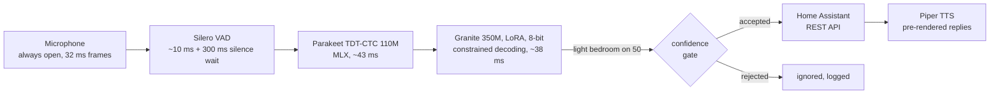

# Voice home assistant: local voice control in under 100 ms

[](https://github.com/raczcsaba/voiceassistant/actions/workflows/ci.yml)
[](LICENSE)
[](pyproject.toml)

A hands-free voice assistant for Home Assistant that runs entirely on an 8 GB M2 MacBook: no cloud, no GPU server.
An always-open microphone feeds a voice activity detector, a 110M-parameter speech recognizer and a 350M-parameter
language model fine-tuned to turn a sentence into one smart-home command, which is then sent to the Home Assistant
REST API. The first prototype (Whisper + a 4 GB LLM via Ollama) needed 5–11 s per command because the models didn't
fit in memory; this version takes about 85 ms from the end of speech to the action.

**Highlights** (measured with `bench.py` / `eval_nlu.py`, raw results in [`results/`](results/))

- **85 ms median, 124 ms worst case** from end of speech to tool call (Parakeet 110M STT 43 ms + parser 38 ms), 16/16 correct on the test set
- **45/48 (94%)** on held-out phrasings the model never saw, **0/26 false triggers** on chatter, fillers and unknown devices
- **~1.3 GB RAM** for the whole assistant including TTS, so it runs alongside normal use on an 8 GB machine
- **Constrained decoding over a token trie** ([`va/fastnlu.py`](va/fastnlu.py)): the model can only emit valid
  tool/target/action/value combinations, and tokens with a single possible continuation are appended without a forward pass
- **LoRA fine-tune** of IBM Granite 4.0 350M on 4,000 synthetic commands ([`train/gen_data.py`](train/gen_data.py)),
  ~3 min on the M2; held-out accuracy went from 78% (few-shot) to 94%
- **Confidence gate**: commands below 0.5 are ignored, unlocking the front door needs 0.9
- Benchmark harness that compares STT backends (Parakeet, Moonshine, Whisper, Groq, Deepgram) and command parsers (MLX, Ollama, Groq, Claude) on accuracy and latency

**Tech stack:** Python · MLX / mlx-lm · Parakeet (parakeet-mlx) · Silero VAD (ONNX Runtime) · Piper TTS ·
Home Assistant REST and WebSocket APIs · pytest · ruff · GitHub Actions. Also JavaScript (Lovelace cards, Canvas/WebGL)
and a small Java Android app.



Not every sound is a command: the parser is trained with ~25% "do nothing" examples (fillers, chatter, half
sentences, unknown devices) and ignored input is logged but not spoken about. With hands-free VAD, add the 300 ms
end-of-speech wait: about 0.4 s from your last syllable to the action.

## Setup

Needs macOS on Apple Silicon (8 GB is enough) and Python 3.11+.

```bash
python3 -m venv .venv && source .venv/bin/activate
pip install -r requirements.txt

# Voice activity detection model
mkdir -p models
curl -L -o models/silero_vad.onnx https://github.com/snakers4/silero-vad/raw/master/src/silero_vad/data/silero_vad.onnx

# The command parser: generate training data, fine-tune and quantize Granite 350M (~3 min on an M2).
# Same commands as "Retraining the command model" below.
python train/gen_data.py
python -m mlx_lm lora --model ibm-granite/granite-4.0-350m --train --data train/data --iters 900 \
  --batch-size 8 --num-layers 16 --learning-rate 2e-4 --mask-prompt --max-seq-length 96 --adapter-path adapters/granite-350m
python -m mlx_lm fuse --model ibm-granite/granite-4.0-350m --adapter-path adapters/granite-350m --save-path models/granite-350m-cmd
python -m mlx_lm convert --hf-path models/granite-350m-cmd --mlx-path models/granite-350m-cmd-q8 -q --q-bits 8
```

The Parakeet speech model downloads from Hugging Face on first run, and the Piper voice
(`en_US-lessac-low`) downloads itself into `voices/`. For the real-home mode, copy
`home_entities.example.json` to `home_entities.json` and set `HA_URL` and `HA_TOKEN` (see `.env.example`
for the optional cloud backends used in the benchmarks).

## Quick start

```bash
source .venv/bin/activate
python assistant.py            # hands-free: just talk ("turn on the kitchen lights")
python assistant.py --ptt      # push-to-talk (Enter / Enter)
python assistant.py --tts      # + spoken confirmations
python assistant.py --ha       # real Home Assistant: HA_URL, HA_TOKEN, home_entities.json (see example)
```
Terminal needs microphone permission (System Settings → Privacy & Security → Microphone).

## Why it is fast (what changed vs. the first 11 s version)

| Problem | Fix | Effect |
|---|---|---|
| 4 GB LLM + STT on 8 GB RAM → swapping (5–11 s) | 350M-parameter models, ~1.3 GB total; weights wired in RAM | no paging, stable latency |
| Whisper large / Parakeet 0.6B, Hungarian | English Parakeet TDT-CTC 110M on MLX, audio passed in memory (no temp file / ffmpeg) | 1050 ms → **43 ms**, WER 1.1% |
| Ollama (llama.cpp, HTTP, JSON tool calls ~25–50 tokens at ~95 tok/s) | in-process MLX, system prompt KV-cached once, compact output | 250 ms → 57 ms |
| Model writes every JSON character | **constrained decoding over a token trie**: only valid values for the chosen tool; forced tokens skipped ("jump-forward") → model runs only at real decision points | ~4–6 small forward passes per command |
| Few-shot prompting tops out at ~78% on unseen phrasing | **LoRA fine-tune** on 4k synthetic commands (`train/`), merged + 8-bit quantized | 78% → **94%**, 57 → **38 ms** |
| Push-to-talk / device open per command | always-open mic, Silero VAD (~10 ms/command), 320 ms pre-roll | hands-free |
| TTS synthesis latency | Piper voice, fixed confirmations rendered at startup | playback starts immediately |

## Benchmarks (`results/`)

End to end on synthetic audio (`python bench.py`):

| STT | Command parser | median | max | correct |
|---|---|---|---|---|
| **parakeet-110m** | **granite-cmd-q8 (fine-tuned)** | **85 ms** | 124 ms | 16/16 |
| moonshine-tiny | granite-cmd-q8 | 71 ms | 126 ms | 15/16 |
| parakeet-110m | qwen3.5-0.8b (few-shot, not fine-tuned) | 119 ms | 166 ms | 15/16 |
| parakeet-110m | granite4:350m via Ollama, JSON | 312 ms | 343 ms | 15/16 |
| parakeet-v3 (Hungarian) | qwen3.5:4b via Ollama, tool calls | 2879 ms | 6882 ms | 13/14 |

Held-out phrasing test (`python eval_nlu.py`, 48 commands never used for prompts or training):

| parser | correct | median |
|---|---|---|
| **granite-cmd-q8** (fine-tuned, fused, 8-bit, with "none" training) | **45/48**, 0/26 false triggers | **39 ms** |
| granite-cmd-q4 | 43/48 | 35 ms |
| lfm2.5-1.2b (few-shot) | 38/48 | 77 ms |
| qwen3.5-0.8b (few-shot) | 37/48 | 71 ms |
| granite-350m (few-shot) | 33/48 | 60 ms |

STT alone: moonshine-tiny 33 ms (WER 17%), parakeet-110m 43 ms (1.1%), moonshine-base 50 ms (11%),
whisper-tiny.en 41 ms (10%), parakeet-v2 116 ms. TTS: Piper lessac-low 46 ms, macOS `say` 540 ms.

Caveat: test audio is synthetic (macOS voice). Record your own voice with `python record.py` and rerun
`python bench.py` — it uses `audio/en/rec/` automatically.

## Tests

The pure-logic parts run anywhere, without MLX, models, a microphone or Home Assistant: constrained decoding
(with a fake tokenizer and a scripted model), the HA service mapping (mocked HTTP), VAD endpointing (scripted
probabilities), scoring and the poem builder.

```bash
pip install -e ".[dev]"
ruff check . && pytest
```

## Retraining the command model (e.g. new rooms/devices)

Edit the vocab in `va/common.py` / templates in `train/gen_data.py`, then:
```bash
python train/gen_data.py
python -m mlx_lm lora --model ibm-granite/granite-4.0-350m --train --data train/data --iters 900 \
  --batch-size 8 --num-layers 16 --learning-rate 2e-4 --mask-prompt --max-seq-length 96 --adapter-path adapters/granite-350m
python -m mlx_lm fuse --model ibm-granite/granite-4.0-350m --adapter-path adapters/granite-350m --save-path models/granite-350m-cmd
python -m mlx_lm convert --hf-path models/granite-350m-cmd --mlx-path models/granite-350m-cmd-q8 -q --q-bits 8
python eval_nlu.py granite-cmd-q8
```
~3 min training on the M2. (LFM2 models collapsed under LoRA in mlx-lm; Qwen3.5-0.8B training ran out of GPU
memory on 8 GB because of its 250k vocabulary — Granite 350M trains cleanly.)

## Files

`assistant.py` live loop · `bench.py` STT/LLM matrix · `eval_nlu.py` held-out parser test · `va/fastnlu.py` MLX
constrained parser · `va/stt.py` STT backends · `va/llm.py` parser/LLM registry (incl. Ollama, Groq, Claude for
comparison) · `va/listen.py` mic + VAD · `va/tts.py` Piper · `va/home.py` mock / Home Assistant · `train/` data generator.
Hungarian profile still available: `python bench.py --lang hu` (Parakeet v3 STT is ~180 ms when memory isn't contended).

## Also in this repo

These grew around the assistant and run on the same Home Assistant setup:

| Folder / file | What it is |
|---|---|
| `ha_voice.py`, `voice_app.py` | Client for Home Assistant's own Assist pipeline over the websocket API, with timings, and a macOS menu-bar app on top (wake word via openWakeWord). Set `HA_HOST` (default `homeassistant.local:8123`) and put a long-lived token in `~/.config/voice-test/ha-token` |
| `tablet-kiosk/home-panel.js` | Lovelace custom card: music and TV now-playing, lights, desk monitor switching, Music Assistant / Jellyfin library browser and a daily poem. Entities are set in the card config (`players`, `lights`, `tv`, …; see the comment above `setConfig`) |
| `tablet-kiosk/immich_frame/` | Small Home Assistant integration that proxies random Immich photos to the screensaver, so the card never sees the Immich API key |
| `s20-kiosk/amoled-saver.js` | Screensaver card with ~40 clock, canvas and WebGL styles plus the Immich photo frame |
| `s20-kiosk/adbkeeper/` | Tiny Android app (built without Gradle, `build.sh`) that keeps wireless ADB alive on a kiosk phone |
| `tablet-kiosk/*.sh`, `*/disabled-packages.txt` | Debloat lists and helper scripts for turning an Android phone/tablet into a wall panel |
| `poems/build_poems.py` | Builds the daily-poem collection from Hungarian Wikisource, public-domain poets only. `--split` writes the per-day files the card reads from `/local/poems/` |
| `poems/higgs_poem.py`, `tts_*.py` | Experiments: reading the poems aloud with Higgs Audio TTS on a Linux GPU box (`AI_ROOT`) |
| `tv_vibe/` | Generates a Home Assistant script that plays random calm YouTube videos on an Android TV over ADB (`TV_ADB_ENTITY`) |
| `research_notes/`, `reports/` | Notes on Hungarian and code-switching speech recognition |

## License

[MIT](LICENSE). Poem texts are not included; the builder fetches public-domain poems from Wikisource.
