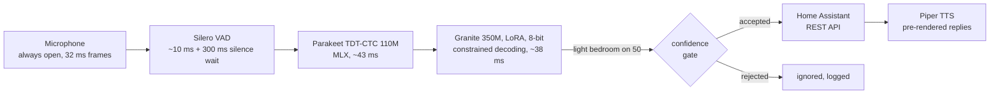

# Voice home assistant: local voice control in under 100 ms

[](https://github.com/raczcsaba/voiceassistant/actions/workflows/ci.yml)
[](LICENSE)
[](pyproject.toml)

A hands-free voice assistant for Home Assistant that runs entirely on an 8 GB M2 MacBook: no cloud, no GPU server.
An always-open microphone feeds a voice activity detector, a 110M-parameter speech recognizer and a 350M-parameter
language model fine-tuned to turn a sentence into one smart-home command, which is then sent to the Home Assistant
REST API. The first prototype (Whisper + a 4 GB LLM via Ollama) needed 5–11 s per command because the models didn't
fit in memory; this version takes about 85 ms from the end of speech to the action.

**Highlights** (measured with `bench.py` / `eval_nlu.py`, raw results in [`results/`](results/))

- **85 ms median, 124 ms worst case** from end of speech to tool call (Parakeet 110M STT 43 ms + parser 38 ms), 16/16 correct on the test set
- **45/48 (94%)** on held-out phrasings the model never saw, **0/26 false triggers** on chatter, fillers and unknown devices
- **~1.3 GB RAM** for the whole assistant including TTS, so it runs alongside normal use on an 8 GB machine
- **Constrained decoding over a token trie** ([`va/fastnlu.py`](va/fastnlu.py)): the model can only emit valid
  tool/target/action/value combinations, and tokens with a single possible continuation are appended without a forward pass
- **LoRA fine-tune** of IBM Granite 4.0 350M on 4,000 synthetic commands ([`train/gen_data.py`](train/gen_data.py)),
  ~3 min on the M2; held-out accuracy went from 78% (few-shot) to 94%
- **Confidence gate**: commands below 0.5 are ignored, unlocking the front door needs 0.9
- Benchmark harness that compares STT backends (Parakeet, Moonshine, Whisper, Groq, Deepgram) and command parsers (MLX, Ollama, Groq, Claude) on accuracy and latency

**Tech stack:** Python · MLX / mlx-lm · Parakeet (parakeet-mlx) · Silero VAD (ONNX Runtime) · Piper TTS ·
Home Assistant REST and WebSocket APIs · pytest · ruff · GitHub Actions. Also JavaScript (Lovelace cards, Canvas/WebGL)
and a small Java Android app.



Not every sound is a command: the parser is trained with ~25% "do nothing" examples (fillers, chatter, half
sentences, unknown devices) and ignored input is logged but not spoken about. With hands-free VAD, add the 300 ms
end-of-speech wait: about 0.4 s from your last syllable to the action.

## Setup

Needs macOS on Apple Silicon (8 GB is enough) and Python 3.11+.

```bash
python3 -m venv .venv && source .venv/bin/activate
pip install -r requirements.txt

# Voice activity detection model
mkdir -p models
curl -L -o models/silero_vad.onnx https://github.com/snakers4/silero-vad/raw/master/src/silero_vad/data/silero_vad.onnx

# The command parser: generate training data, fine-tune and quantize Granite 350M (~3 min on an M2).
# Same commands as "Retraining the command model" below.
python train/gen_data.py
python -m mlx_lm lora --model ibm-granite/granite-4.0-350m --train --data train/data --iters 900 \
  --batch-size 8 --num-layers 16 --learning-rate 2e-4 --mask-prompt --max-seq-length 96 --adapter-path adapters/granite-350m
python -m mlx_lm fuse --model ibm-granite/granite-4.0-350m --adapter-path adapters/granite-350m --save-path models/granite-350m-cmd
python -m mlx_lm convert --hf-path models/granite-350m-cmd --mlx-path models/granite-350m-cmd-q8 -q --q-bits 8
```

The Parakeet speech model downloads from Hugging Face on first run, and the Piper voice
(`en_US-lessac-low`) downloads itself into `voices/`. For the real-home mode, copy
`home_entities.example.json` to `home_entities.json` and set `HA_URL` and `HA_TOKEN` (see `.env.example`
for the optional cloud backends used in the benchmarks).

## Quick start

```bash
source .venv/bin/activate
python assistant.py            # hands-free: just talk ("turn on the kitchen lights")
python assistant.py --ptt      # push-to-talk (Enter / Enter)
python assistant.py --tts      # + spoken confirmations
python assistant.py --ha       # real Home Assistant: HA_URL, HA_TOKEN, home_entities.json (see example)
```
Terminal needs microphone permission (System Settings → Privacy & Security → Microphone).

## Why it is fast (what changed vs. the first 11 s version)

| Problem | Fix | Effect |
|---|---|---|
| 4 GB LLM + STT on 8 GB RAM → swapping (5–11 s) | 350M-parameter models, ~1.3 GB total; weights wired in RAM | no paging, stable latency |
| Whisper large / Parakeet 0.6B, Hungarian | English Parakeet TDT-CTC 110M on MLX, audio passed in memory (no temp file / ffmpeg) | 1050 ms → **43 ms**, WER 1.1% |
| Ollama (llama.cpp, HTTP, JSON tool calls ~25–50 tokens at ~95 tok/s) | in-process MLX, system prompt KV-cached once, compact output | 250 ms → 57 ms |
| Model writes every JSON character | **constrained decoding over a token trie**: only valid values for the chosen tool; forced tokens skipped ("jump-forward") → model runs only at real decision points | ~4–6 small forward passes per command |
| Few-shot prompting tops out at ~78% on unseen phrasing | **LoRA fine-tune** on 4k synthetic commands (`train/`), merged + 8-bit quantized | 78% → **94%**, 57 → **38 ms** |
| Push-to-talk / device open per command | always-open mic, Silero VAD (~10 ms/command), 320 ms pre-roll | hands-free |
| TTS synthesis latency | Piper voice, fixed confirmations rendered at startup | playback starts immediately |

## Benchmarks (`results/`)

End to end on synthetic audio (`python bench.py`):

| STT | Command parser | median | max | correct |
|---|---|---|---|---|
| **parakeet-110m** | **granite-cmd-q8 (fine-tuned)** | **85 ms** | 124 ms | 16/16 |
| moonshine-tiny | granite-cmd-q8 | 71 ms | 126 ms | 15/16 |
| parakeet-110m | qwen3.5-0.8b (few-shot, not fine-tuned) | 119 ms | 166 ms | 15/16 |
| parakeet-110m | granite4:350m via Ollama, JSON | 312 ms | 343 ms | 15/16 |
| parakeet-v3 (Hungarian) | qwen3.5:4b via Ollama, tool calls | 2879 ms | 6882 ms | 13/14 |

Held-out phrasing test (`python eval_nlu.py`, 48 commands never used for prompts or training):

| parser | correct | median |
|---|---|---|
| **granite-cmd-q8** (fine-tuned, fused, 8-bit, with "none" training) | **45/48**, 0/26 false triggers | **39 ms** |
| granite-cmd-q4 | 43/48 | 35 ms |
| lfm2.5-1.2b (few-shot) | 38/48 | 77 ms |
| qwen3.5-0.8b (few-shot) | 37/48 | 71 ms |
| granite-350m (few-shot) | 33/48 | 60 ms |

STT alone: moonshine-tiny 33 ms (WER 17%), parakeet-110m 43 ms (1.1%), moonshine-base 50 ms (11%),
whisper-tiny.en 41 ms (10%), parakeet-v2 116 ms. TTS: Piper lessac-low 46 ms, macOS `say` 540 ms.

Caveat: test audio is synthetic (macOS voice). Record your own voice with `python record.py` and rerun
`python bench.py` — it uses `audio/en/rec/` automatically.

## Tests

The pure-logic parts run anywhere, without MLX, models, a microphone or Home Assistant: constrained decoding
(with a fake tokenizer and a scripted model), the HA service mapping (mocked HTTP), VAD endpointing (scripted
probabilities), scoring and the poem builder.

```bash
pip install -e ".[dev]"
ruff check . && pytest
```

## Retraining the command model (e.g. new rooms/devices)

Edit the vocab in `va/common.py` / templates in `train/gen_data.py`, then:
```bash
python train/gen_data.py
python -m mlx_lm lora --model ibm-granite/granite-4.0-350m --train --data train/data --iters 900 \
  --batch-size 8 --num-layers 16 --learning-rate 2e-4 --mask-prompt --max-seq-length 96 --adapter-path adapters/granite-350m
python -m mlx_lm fuse --model ibm-granite/granite-4.0-350m --adapter-path adapters/granite-350m --save-path models/granite-350m-cmd
python -m mlx_lm convert --hf-path models/granite-350m-cmd --mlx-path models/granite-350m-cmd-q8 -q --q-bits 8
python eval_nlu.py granite-cmd-q8
```
~3 min training on the M2. (LFM2 models collapsed under LoRA in mlx-lm; Qwen3.5-0.8B training ran out of GPU
memory on 8 GB because of its 250k vocabulary — Granite 350M trains cleanly.)

## Files

`assistant.py` live loop · `bench.py` STT/LLM matrix · `eval_nlu.py` held-out parser test · `va/fastnlu.py` MLX
constrained parser · `va/stt.py` STT backends · `va/llm.py` parser/LLM registry (incl. Ollama, Groq, Claude for
comparison) · `va/listen.py` mic + VAD · `va/tts.py` Piper · `va/home.py` mock / Home Assistant · `train/` data generator.
Hungarian profile still available: `python bench.py --lang hu` (Parakeet v3 STT is ~180 ms when memory isn't contended).

## Also in this repo

These grew around the assistant and run on the same Home Assistant setup:

| Folder / file | What it is |
|---|---|
| `ha_voice.py`, `voice_app.py` | Client for Home Assistant's own Assist pipeline over the websocket API, with timings, and a macOS menu-bar app on top (wake word via openWakeWord). Set `HA_HOST` (default `homeassistant.local:8123`) and put a long-lived token in `~/.config/voice-test/ha-token` |
| `tablet-kiosk/home-panel.js` | Lovelace custom card: music and TV now-playing, lights, desk monitor switching, Music Assistant / Jellyfin library browser and a daily poem. Entities are set in the card config (`players`, `lights`, `tv`, …; see the comment above `setConfig`) |
| `voice_brain/custom_components/voice_brain/` | Home Assistant conversation agent for the Hungarian voice satellites: a small local model for quick device control, everything else handed to a Claude worker. See [Voice Brain routing](#voice-brain-routing) |
| `tablet-kiosk/immich_frame/` | Small Home Assistant integration that proxies random Immich photos to the screensaver, so the card never sees the Immich API key |
| `s20-kiosk/amoled-saver.js` | Screensaver card with ~40 clock, canvas and WebGL styles plus the Immich photo frame |
| `s20-kiosk/adbkeeper/` | Tiny Android app (built without Gradle, `build.sh`) that keeps wireless ADB alive on a kiosk phone |
| `tablet-kiosk/*.sh`, `*/disabled-packages.txt` | Debloat lists and helper scripts for turning an Android phone/tablet into a wall panel |
| `poems/build_poems.py` | Builds the daily-poem collection from Hungarian Wikisource, public-domain poets only. `--split` writes the per-day files the card reads from `/local/poems/` |
| `poems/higgs_poem.py`, `tts_*.py` | Experiments: reading the poems aloud with Higgs Audio TTS on a Linux GPU box (`AI_ROOT`) |
| `tv_vibe/` | Generates a Home Assistant script that plays random calm YouTube videos on an Android TV over ADB (`TV_ADB_ENTITY`) |
| `research_notes/`, `reports/` | Notes on Hungarian and code-switching speech recognition |
| `stt/` | The satellites' speech-to-text server (Wyoming): Parakeet for English, a Hungarian Whisper for Hungarian, with a hallucination guard and a benchmark. See [Hungarian speech-to-text server](#hungarian-speech-to-text-server-stt) |

## Voice Brain routing

`voice_brain` is a custom conversation agent (`conversation.voice_brain`). Every transcript first goes to a local
llama.cpp model (Qwen3-4B, `LLM_URL` in `conversation.py`) that returns `{"a": action, "d": device, "q": query, "n": number}`
under a JSON schema; the prompt and schema live in `prompt.py`.

**Local fast path** (answers in about 0.3 s from a fixed Hungarian template):
`on` / `off` / `brightness`, TV on/off, `pause` / `resume` / `next` / `stop`, `volume_up` / `volume_down`,
and films whose title matches the Jellyfin library with similarity ≥ 0.9 (original or Hungarian title, `titles.best`).

**Quick worker actions** go to the worker's `/quick` or `/cancel` and speak its short reply:
`like` ("ez tetszik", "lájkold", "kedvencekhez"), `save_to_playlist` with `q` = playlist ("mentsd el a rock listába"),
and `cancel` ("Claude állj", "hagyd abba Claude", "mégse"; matched by a regex before the model, so it's instant).

**Claude hand-off**: `music`, `music_only`, `none` (questions, mood queues, playlist building, recommendations) and
uncertain films POST the *original* transcript to the worker's `/task` (2 s timeout) together with the
`assist_satellite` entity it came from (`ConversationInput.satellite_id`, or the satellite entity on `device_id`).
The agent says the worker's ack ("Szólok Claude-nak."); the worker then announces its status and answer on that satellite.
If the local model itself doesn't answer, the transcript is handed off too.

**Fallbacks** when the worker is unreachable or answers `accepted: false`: music and films say why (the worker's `say`,
e.g. the budget message, or "Claude most nem elérhető.") and then do the old local thing (Music Assistant `play_media`,
fuzzy Jellyfin title match). Anything else just says that.

The worker URL is `WORKER_URL` at the top of `worker.py`; a config entry option `worker_url` overrides it.

### Dashboard endpoints

Authenticated Home Assistant views (`views.py`) forward to the worker, so the browser never talks to it directly.
All answer HTTP 200 with the worker's JSON, or `{"ok": false, "reason": "unreachable", "say": ...}`.

| Endpoint | Body | Worker call |
|---|---|---|
| `POST /api/voice_brain/like` | `{"player"?}` | `/quick` `like` |
| `GET /api/voice_brain/playlists` | | `/quick` `list_playlists` → `playlists: [{name, uri, id}]` |
| `POST /api/voice_brain/save` | `{"playlist", "player"?}` | `/quick` `save_to_playlist` |

`tablet-kiosk/home-panel.js` uses them: the heart in the now-playing card likes the song through the worker
(falling back to Music Assistant's favourite button if the worker is down), and the playlist button opens a picker
of the worker's playlists. Both show the worker's `say` text as a toast.

## Hungarian speech-to-text server (`stt/`)

Home Assistant's `stt.parakeet_onnx` is a Wyoming server (`stt/stt_server.py`, port 10300) on the GPU box:

- **English**: Parakeet TDT 0.6B v3 (int8 ONNX, CPU).
- **Hungarian**: a Hungarian fine-tune of Whisper large-v3-turbo on `whisper-server` (whisper.cpp, Vulkan, `127.0.0.1:8090`).
  Parakeet is the fallback.

| Path | Deployed to |
|---|---|
| `stt/stt_server.py` | `/opt/voice/stt_server.py` |
| `stt/systemd/voice-stt.service`, `voice-whisper.service` | `/etc/systemd/system/` |
| `stt/bench/bench_stt.py` | run from `/opt/voice/stt-bench` |
| `stt/prompt/` | not installed (see "Vocabulary prompt") |

Settings are environment variables in `voice-stt.service`, and nothing secret lives in the code.

### What changed (2026-11)

- **Long clips no longer fail.**
  - `whisper-server` ran with `-ac 400`, which limits the audio window to about 8 s. Longer commands lost their end, and a 10.5 s clip made the decoder fail. The client then hit its fixed 5 s timeout, and the Parakeet fallback ran only after that, for 6.2 s in total.
  - The server now sends `audio_ctx` with each request: at least 1000 frames (20 s), more for longer clips (`WHISPER_CTX_MIN`, `WHISPER_CTX_PAD`).
  - The timeout grows with the clip: 2 s + 0.6 × its length, at most 15 s.
- **Faster fallback.**
  - If whisper hasn't answered after 1 s (+0.05 s per audio second), Parakeet starts as well.
  - After 2 s (+0.1 s per audio second), whichever answers first wins. A stuck GPU now costs about 2.6 s instead of 6+ s.
  - A whisper error falls back at once.
- **No language detection.** `verbose_json` replies used to run language detection, which cost about 150 ms. `no_language_probabilities` turns it off.
- **Hallucination guard** (`STT_GUARD=1`): the server returns empty text, and HA's "no text recognised", instead of garbage.
  - **Silence and noise.** Silero VAD (`/opt/voice/models/silero_vad.onnx`, about 15 ms per clip) runs before whisper. Clips with less than 0.2 s of speech never reach the GPU. whisper-server works one request at a time, and on silence it can loop for seconds.
  - **Subtitle and outro phrases** ("Feliratozta", "Köszönöm a figyelmet", URLs…) are dropped.
  - **Decoder loops** ("Az a szörnyet, a szörnyet, a szörnyet") are cut back to one copy. The reply is dropped if what remains is only a couple of words or there was hardly any speech.
  - **Low confidence.** A reply is also dropped when whisper's `no_speech_prob` is high and its `avg_logprob` low.
- **Onset in the log.** Every request logs its onset: the quiet time before the first loud frame. A value near 0 ms means the satellite already cut off the first word.
- **Debug audio on request.** While `/opt/voice/stt-debug/` exists, the first 20 requests are saved there as WAV files. Delete the folder when you are done.

### Benchmark

`stt/bench/bench_stt.py` builds the test set with Piper (`hu_HU-anna-medium`, `hu_HU-imre-medium`, in a throwaway venv in `/opt/voice/stt-bench`):

- 30 commands with English names written as a Hungarian would say them;
- each command clean, with the first 150 ms of speech cut off, and with pink noise at 10 dB SNR;
- 3 long clips of about 10 s;
- 6 clips of silence or noise, where the right answer is empty.

`--real DIR` runs the same three conditions on your own recordings (`phrases.tsv`).

```bash
cd /opt/voice/stt-bench
/opt/voice/venv/bin/python src/bench/bench_stt.py gen
/opt/voice/venv/bin/python src/bench/bench_stt.py wyoming 127.0.0.1:10300 --tag now
/opt/voice/venv/bin/python src/bench/bench_stt.py whisper --audio-ctx 400 --no-prompt --tag ac400
```

End-to-end results through Wyoming, as HA calls it. TTS set: 60 clips per condition; real set: the owner's 24 recordings.

| | before | after |
|---|---|---|
| TTS clean: WER / names / p50 latency | 35.4% / 8 of 40 / 302 ms | 32.2% / 10 of 40 / 448 ms |
| TTS, 150 ms onset cut | 53.2% | 49.0% |
| TTS + noise (10 dB) | 41.1% | 36.6% |
| Long clips (~10 s): WER / max latency | 85.4% / 6.0 s (one timeout, decoder loops) | 12.5% / 1.17 s |
| Silence/noise clips with text | 6 of 6 | 0 of 6 (18 ms) |
| Real recordings: clean / cut / noise | 25.0 / 21.2 / 27.9% | 24.0 / 22.1 / 28.8% |
| Whisper stuck (simulated) | 5 s + Parakeet | 2.6 s (3 s clip), 3.6 s (10 s clip) |

Synthetic speech is cleaner and more regular than a kiosk microphone, so the absolute numbers are optimistic. Compare the rows with each other, not with real life.

Audio window, whisper alone (TTS clean / cut / noise WER, p50):

| Window | WER clean / cut / noise | p50 |
|---|---|---|
| 400 | 35.0 / 52.9 / 40.8% | ~300 ms |
| 750 | 32.8 / 50.3 / 39.2% | 407 ms |
| 1000 | 30.9 / 49.4 / 36.6% | 486 ms |
| 1500 (full) | 31.5 / 46.5 / 37.9% | ~1 s |

The 1000 floor costs about 150 ms. On the real recordings it made no difference. To go back to the old speed for short clips and still fix long ones, set `WHISPER_CTX_MIN=400`.

### Vocabulary prompt (built, measured, not used)

`stt/prompt/` builds a whisper `prompt` of about 200 tokens: a short Hungarian command sentence, then the household's film and series titles (foreign-sounding ones first) and its most-played and favourite artists.

- `fetch_library.py` runs inside the HA container. It reads Music Assistant through HA's own config entry, plus `/config/voice_titles.json`, and prints names only.
- `make_prompt.py` writes the prompt to `/opt/voice/stt_prompt.txt`.
- `refresh-prompt.sh` with `stt-prompt.timer` would run all of this daily on the Proxmox host.

The generated file holds personal library names, so it stays out of the repo.

With the Hungarian fine-tune the prompt makes things much worse:

| Prompt | WER |
|---|---|
| Full prompt | about 100%: the model answers just "D" |
| 120-token prompt | 51% on TTS clean, against 31% without |
| Even "Kapcsold fel a lámpát." | breaks some commands |

The stock large-v3-turbo does use the prompt (names 14 of 40 instead of 9 of 40). But it is no better than the fine-tune without a prompt: real recordings 24.0% vs 24.0%, TTS noise 40.8% vs 36.6%. So the prompt is off. To try it, set `STT_PROMPT_FILE=/opt/voice/stt_prompt.txt`.

## License

[MIT](LICENSE). Poem texts are not included; the builder fetches public-domain poems from Wikisource.
